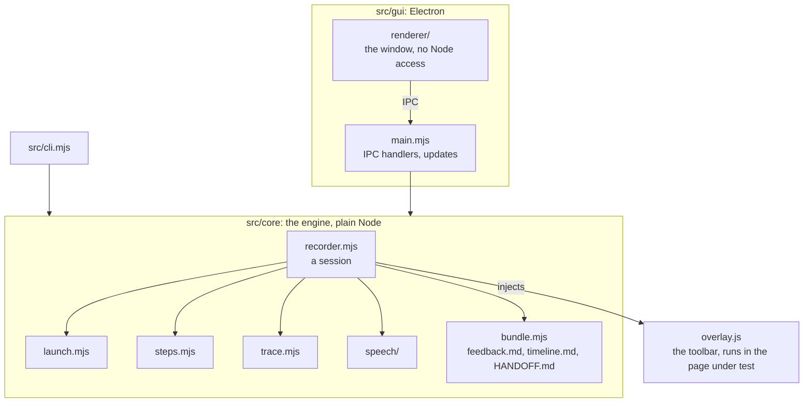

# Developing QA Recorder

How to run QA Recorder from source, how the code fits together, and how to test and release it. Using the app is in
the [README](README.md).

## Run from source

You need Node 22+, plus Chrome or Edge, plus the [GitHub CLI](https://cli.github.com) (logged in) for targets built in
GitHub Actions.

```sh
npm install
npm start          # the desktop app
```

On Windows, `qa-recorder.bat` opens the app without a terminal, and runs `npm install` the first time. For a desktop
shortcut, right-click it and choose **Show more options → Send to → Desktop (create shortcut)**. Then in the shortcut's
**Properties**, choose **Change Icon** and pick `assets\icon.ico`.

A source checkout doesn't update itself: `git pull`, then `npm install`.

### Command line

The CLI does what the app does, except voice (it has no microphone). It only exists in a source checkout.

```sh
node src/cli.mjs start fwlite-maui            # the latest develop build of FW Lite
node src/cli.mjs start --url https://example.org
node src/cli.mjs start my-app --exe path/to/local/build.exe
node src/cli.mjs targets | sessions | builds
node src/cli.mjs cleanup --older-than 30 [--empty]
node src/cli.mjs validate my-target.json
node src/cli.mjs prompt                       # the prompt for an AI to write a target
```

## How it fits together

Plain JavaScript (ES modules), no build step.



| Where | What |
|---|---|
| `src/core/recorder.mjs` | runs a session: launch, attach over CDP, inject the toolbar, record actions, errors, tabs and navigation, write the session folder |
| `src/core/overlay.js` | the toolbar, injected into every page of the app under test. A plain browser script with no imports. It swallows every event that touches the toolbar, so the page never sees it |
| `src/core/launch.mjs` | the launch types: `browser`, `server`, `webview2`, `cdp` |
| `src/core/targets.mjs` | loading, validating and saving targets; `${vars}`; the AI authoring prompt |
| `src/core/builds.mjs` | finding and downloading CI artifacts through `gh` |
| `src/core/bundle.mjs` | the files an agent reads: `feedback.md`, `timeline.md`, `transcript.md`, `HANDOFF.md` |
| `src/core/speech/` | microphone to text. Whisper runs in a child process (`worker.mjs`). `chunker.mjs` cuts open-mic audio into windows without ever dropping speech; `voice.mjs` is push-to-talk; `analyze.mjs` is the mic check |
| `src/gui/main.mjs` | the Electron main process: one IPC handler per thing the window can do |
| `src/gui/renderer/` | the window. A classic script that reaches the core only through `window.qa.invoke` |
| `src/gui/updates.mjs` | self-update from GitHub Releases (installed app only) |
| `configs/` | bundled targets. `qa-recorder.json` is this app recording itself (see [Dogfooding](#dogfooding)) |
| `schema/target.schema.json`, `AUTHORING.md` | the target format, and the guide an AI follows to write a target |

The core knows nothing about any particular app: app specifics belong in a target.

## Test

```sh
npm test               # unit tests
npm run check          # syntax of every source file
npm run smoke:url      # a website target end to end: toolbar, notes, timeline, tabs, trace
npm run smoke:gui      # the desktop app end to end, including the About page and a transcription
npm run smoke:voice    # open mic and push-to-talk, with test/fixtures/speech.wav as the microphone
npm run smoke:fwlite   # Windows: FW Lite's latest develop build end to end
npm run smoke:dogfood  # the qa-recorder target: this app recording itself
```

The smoke tests open real windows on your desktop, and each uses a throwaway data folder. To save downloads, the
speech tests share your real model folder.

## Dogfooding

The **QA Recorder (this app)** target runs this checkout's app with its own empty data folder and records it with
itself. Record a session on it, then hand the session to an agent working in this repo. It shares your downloaded
builds, so deleting builds inside it deletes yours.

## The installer

```sh
npm run dist       # dist/QA-Recorder-Setup-<version>.exe, and the unpacked app in dist/win-unpacked
QA_RECORDER_EXE="dist/win-unpacked/QA Recorder.exe" npm run smoke:gui   # the GUI test against the packaged app
```

electron-builder's config is the `build` field in `package.json`. The app is packaged as plain files, not an asar
archive, because the speech worker, Playwright's trace viewer and the bundled configs all run or load from disk. The
package leaves out the dogfood target, the speech engine's binaries for other platforms, and `onnxruntime-web`, which
Node never loads.

## Releasing

```sh
npm version minor        # or patch: bumps package.json and makes the v<version> tag
git push --follow-tags
```

The tag starts the Release workflow (`.github/workflows/release.yml`). It runs the unit tests, builds the installer,
and publishes it as a GitHub release. Installed copies pick that up as an update. The installer isn't code-signed.

## Icon and screenshots

- `assets/icon.svg` is the icon. After changing it, `node scripts/make-icon.mjs` remakes `icon.png` and `icon.ico`.
- `node scripts/readme-screenshots.mjs` retakes the README's screenshots. It records a session on a made-up shop
  (`scripts/demo-site/`) in a throwaway data folder, so no real sessions or user names end up in them. Run it after
  changing the toolbar or the session page.
