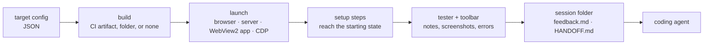

# qa-recorder

Record a QA session of any app or website, with a feedback toolbar injected into it, and hand the notes to a coding
agent. Nothing is built into the thing under test: qa-recorder attaches over the Chrome DevTools protocol.



## Requirements

- Node 22+
- Chrome or Edge for website and server targets
- [GitHub CLI](https://cli.github.com), logged in, for targets whose build is a GitHub Actions artifact
- Windows for WebView2 targets such as FW Lite

## Use

```sh
npm install
npm start                       # the desktop app
```

In the app you pick a target, check for and download new CI builds, start a session, watch notes arrive, open the
session's feedback, copy the hand-off line for your agent, and clean up old sessions and builds.

The same things work from the command line:

```sh
node src/cli.mjs start fwlite-maui            # the latest develop build of FW Lite
node src/cli.mjs start --url https://example.org
node src/cli.mjs start my-app --exe path/to/local/build.exe
node src/cli.mjs targets | sessions | builds
node src/cli.mjs cleanup --older-than 30 [--empty]
node src/cli.mjs validate my-target.json
node src/cli.mjs prompt                       # the prompt for an AI to write a target
```

## While testing

| Key | Action |
|---|---|
| F8 | pick an element, then write a note about it |
| F9 | drag a region, then write a note about it |
| F7 | a general note |
| Esc | cancel a capture |

Each note has a type (🐛 bug, 👎 dislike, 💡 idea, 👍 like) and free text, and is written to disk as soon as you save
it. ⇄ moves the toolbar to the other side. **Finish** (twice) ends the session and closes the app; closing the app or
the browser also ends it.

The toolbar is invisible to the page: it swallows its own clicks, keys and focus changes before the page's listeners
run, so an open popup or menu stays open while you capture a note about it.

## Targets

A target is a JSON file. Bundled ones are in `configs/`; yours are in `<data>/targets/` (an edited bundled target is
saved there too, under the same id). The schema is `schema/target.schema.json`, so editors with JSON Schema support
complete and check it.

The smallest target:

```json
{ "name": "Docs site", "launch": { "type": "browser", "url": "https://docs.example.org" } }
```

[`configs/fwlite-maui.json`](configs/fwlite-maui.json) uses everything: a CI artifact build, a WebView2 app with
environment variables that keep it away from real data, setup steps that open the example project, an ignore rule
for noise in the error log, and hints for the agent.

| Part | What it does |
|---|---|
| `build` | `github-actions` (repo, workflow, branch, artifact; latest successful run, cached) or `local` (a folder) |
| `launch` | `browser` (url), `server` (start exe, wait for readyUrl, open url), `webview2` (Windows WebView2 app), `cdp` (Electron app with `--remote-debugging-port=${port}`, or attach to `cdpUrl`) |
| `setup` | steps after attaching: `goto`, `navigate`, `click`, `fill`, `press`, `waitFor`, `waitForUrl`, `wait`, `script`; with `ifVisible`, `optional`, `timeout` |
| `capture.ignore` | leave matching events out of the error log (`type`, `text`, `url`; `*` wildcard) |
| `handoff` | `workspace`, `context`, `hints` for HANDOFF.md |

Strings can use `${appData}` (an empty folder per session), `${sessionDir}`, `${buildDir}`, `${port}`, `${arch}`,
`${platform}`, `${targetDir}`, `${build.sha}`, `${build.branch}`, `${build.runId}`, `${build.url}` and `${env:NAME}`.

To make a new target in the app: paste a URL, or **Copy AI prompt** ([AUTHORING.md](AUTHORING.md) plus the schema),
give it to an AI, answer its questions, and paste the JSON it writes. The editor checks it as you type.

## Data

Under `%LOCALAPPDATA%\qa-recorder` (or `~/.cache/qa-recorder`; set `QA_RECORDER_HOME` to move it):

| Folder | Contents |
|---|---|
| `sessions/<time>_<target>/` | `feedback.md`, `HANDOFF.md`, `notes/` screenshots, `events.json` (errors, navigation), `session.json`, `.app-data/` (the app's data for this session) |
| `builds/` | downloaded CI artifacts |
| `targets/` | your targets |
| `profiles/` | browser profiles for targets with `"profile": "persistent"` |

To hand a session off, start a coding agent in the project's repo and say `Read <session>/HANDOFF.md and follow it.`
(the app's **Copy hand-off** button copies that line).

## FW Lite notes

Each FW Lite session gets a fresh data folder: projects, logs, auth cache, WebView2 profile, and an empty FieldWorks
projects folder in place of the one in the registry. Analytics and update checks are off. FW Lite still saves the
last page in MAUI preferences under your user profile; builds with `--start-url` (sillsdev/languageforge-lexbox#2944)
ignore it at launch, and the setup's `navigate` step covers older builds.

## Test

```sh
npm test               # unit tests: schema, variables, matching
npm run check          # syntax of every source file
npm run smoke:url      # website target end to end (opens Chrome/Edge)
npm run smoke:gui      # the desktop app end to end (opens the app and browsers)
npm run smoke:fwlite   # Windows: FW Lite's latest develop build end to end
```

## Not yet

- Native windows and dialogs (file pickers, title bars) are outside the web view, so the toolbar can't see them.
- A packaged build of the desktop app; for now run it from a clone.
- Ideas: rrweb replay of the session, hold-to-talk voice notes transcribed locally.
