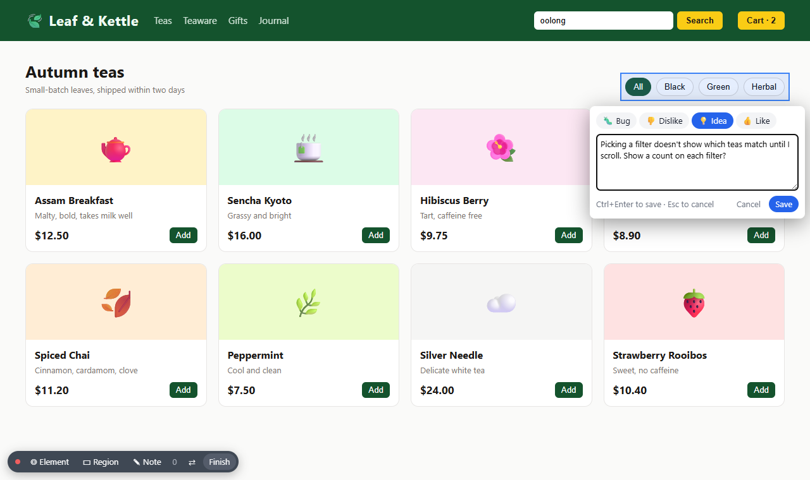
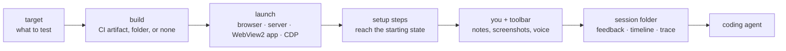
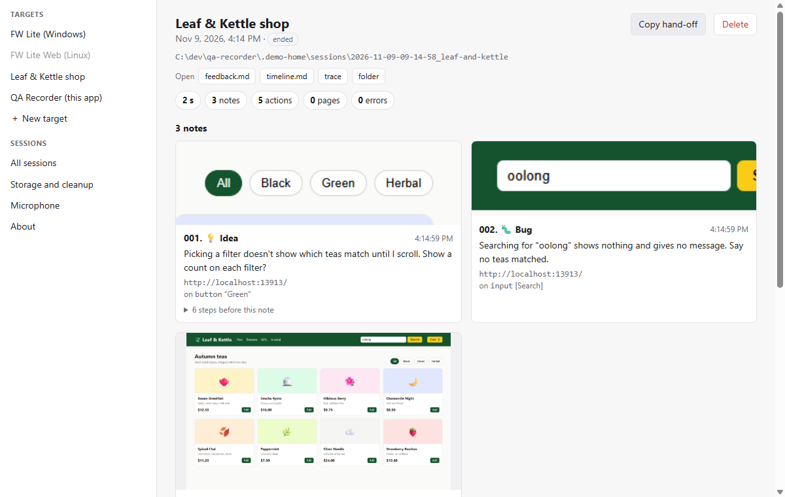
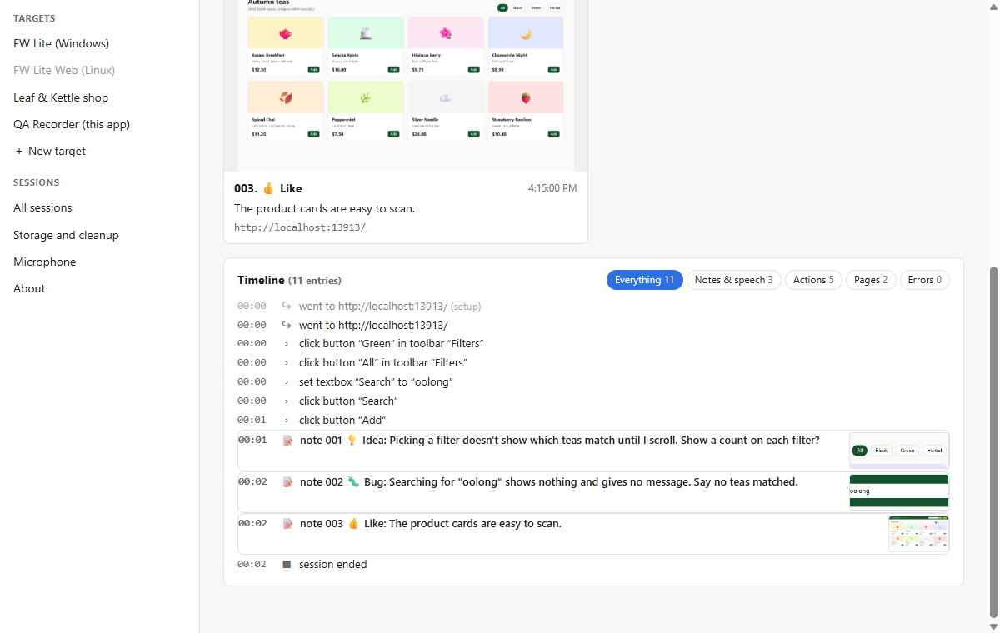

# QA Recorder

Record a QA session of any app or website, with a feedback toolbar injected into it, and hand the notes to a coding
agent. Nothing is built into the thing under test: QA Recorder attaches to it over the Chrome DevTools protocol.





## Install

On Windows, download `QA-Recorder-Setup-<version>.exe` from the
[latest release](https://github.com/hahn-kev-bot/qa-recorder/releases/latest) and run it. It installs for your user
only (no admin rights) and adds a Start menu and desktop shortcut.

QA Recorder updates itself: it checks for a new release when it starts, downloads it in the background, and installs
it when you restart it from the About page, or the next time you close it.

The installer isn't code-signed yet, so the first time Windows SmartScreen may warn about an unknown publisher: choose
**More info**, then **Run anyway**.

On macOS or Linux, run it from source: see [DEVELOPER.md](DEVELOPER.md).

You also need:

- Chrome or Edge, for website and server targets
- [GitHub CLI](https://cli.github.com), logged in, for targets whose build is a GitHub Actions artifact

## Record a session

1. **Pick a target**, the thing you're testing, in the sidebar. To add one, choose **＋ New target** and paste a
   URL, or see [Targets](#targets).
2. If the target is built in CI, the app shows the newest build: **Download** it, or start with the one you have.
3. Choose a voice mode next to **▶ Start session** (or no voice) and start. The app or website opens with the toolbar
   in a bottom corner.
4. Use it as you normally would, and leave a note whenever something is wrong, odd, or good.
5. **Finish** on the toolbar (press it twice), or close the app or browser.
6. On the session page, **Copy hand-off** and paste it to a coding agent working in the project's repo. It copies
   `Read <session>/HANDOFF.md and follow it.`, and the agent takes it from there: it reads your notes and screenshots,
   finds the code, and proposes fixes.



## While testing

| Key | Action |
|---|---|
| F8 | pick an element, then write a note about it |
| F9 | drag a region, then write a note about it |
| F7 | a general note |
| F6 (hold) | talk, when push-to-talk is on |
| Esc | cancel a capture |

Each note has a type (🐛 bug, 👎 dislike, 💡 idea, 👍 like) and your text, and is kept as soon as you save it. ⇄
moves the toolbar to the other side.

The toolbar doesn't disturb the page: an open popup or menu stays open while you take a note about it.

Without you doing anything, every session also records:

- **A timeline** of what you did, in words ("click button “Search”", "set textbox “Search” to “kettle”"), plus page
  changes, browser tabs and errors. Each note lists the steps before it. Typed text is recorded, passwords never are.
- **A Playwright trace**: screenshots whenever the screen changes, network requests and console messages. The
  session page's **trace** button opens it in Playwright's Trace Viewer.



## Voice

Choose a mode next to **Start session**; the app remembers it per target. Speech is transcribed on your computer with
Whisper; the model (about 80 MB) downloads the first time.

| Mode | How | Result |
|---|---|---|
| Push-to-talk | hold F6 in the app, or hold 🎙 on its toolbar | each press becomes a 🎙 Spoken note, with a screenshot from when you pressed |
| Open mic | just talk; 🎙 on the toolbar mutes | everything you say is transcribed and lands in the timeline, each remark with a screenshot from when you started speaking |

With open mic the whole session's audio is kept, and the session page plays each remark so you can check it.
**Re-transcribe** on a finished session runs the recording through a larger, much more accurate model (about 760 MB,
downloaded the first time).

**Microphone page** (in the sidebar): pick your microphone, watch its level, and record a 4-second test. It tells you
if the recording is too quiet, muffled, distorted or noisy. Use it once, or when a transcript looks wrong. What
matters most is how far your voice stands out from the background: below about 15 dB, transcripts fall apart. A
headset, or a microphone close to your mouth, helps far more than any setting.

## Targets

A target says what to test and how to start it. The smallest one is a website:

```json
{ "name": "Docs site", "launch": { "type": "browser", "url": "https://docs.example.org" } }
```

Make one in the app (**＋ New target**) in either of two ways:

- **Paste a URL**, for a website.
- **Copy AI prompt**, give the prompt to an AI, answer its questions, and paste the JSON it writes. The editor
  checks it as you type. The prompt is [AUTHORING.md](AUTHORING.md) plus the schema.

What a target can do:

| Part | What it does |
|---|---|
| `build` | where the app comes from: `github-actions` (the latest successful CI run, downloaded and cached) or `local` (a folder) |
| `launch` | how it starts: `browser` (a URL), `server` (start a program, wait for it, open its URL), `webview2` (a Windows WebView2 app), `cdp` (an Electron app, or any app with a debugging port) |
| `setup` | steps to reach the starting state: `goto`, `navigate`, `click`, `fill`, `press`, `waitFor`, `waitForUrl`, `wait`, `script` |
| `capture` | `ignore`: errors to leave out of the log. `typedText: false`: record only how much was typed. `trace: false`: no trace |
| `handoff` | `workspace`, `context` and `hints` for the coding agent |

Strings can use `${appData}` (an empty folder for each session), `${sessionDir}`, `${buildDir}`, `${buildCache}`,
`${port}`, `${arch}`, `${platform}`, `${targetDir}`, `${build.sha}`, `${build.branch}`, `${build.runId}`, `${build.url}`
and `${env:NAME}`. The full reference is [`schema/target.schema.json`](schema/target.schema.json);
[`configs/fwlite-maui.json`](configs/fwlite-maui.json) is an example that uses nearly everything.

Your targets are saved in the data folder. Editing a bundled target saves your copy there too, under the same id.

### FW Lite

The bundled FW Lite targets give each session a fresh data folder (projects, logs, sign-in cache, WebView2 profile,
and an empty FieldWorks projects folder), with analytics and update checks off, so testing never touches your real
projects. FW Lite still remembers the last page it showed; builds with `--start-url`
(sillsdev/languageforge-lexbox#2944) ignore that, and the setup steps cover older builds.

## Your data

Everything stays on your computer: recordings, screenshots and transcripts are never uploaded. It lives in
`%LOCALAPPDATA%\qa-recorder` (`~/.cache/qa-recorder` on Linux and macOS); the About page shows the folders and opens
them.

| Folder | Contents |
|---|---|
| `sessions/` | one folder per session: `feedback.md`, `timeline.md`, `transcript.md`, `HANDOFF.md`, screenshots, audio, the trace, and the app's own data for that session |
| `builds/` | downloaded CI builds |
| `models/` | speech models |
| `targets/` | your targets |
| `profiles/` | browser profiles for targets with `"profile": "persistent"` |

**Storage and cleanup** in the sidebar deletes old sessions and builds. To keep the data somewhere else, set
`QA_RECORDER_HOME` (everything), `QA_RECORDER_BUILDS` (just builds) or `QA_RECORDER_MODELS` (just speech models).

## Limits

- Native windows and dialogs (file pickers, title bars) are outside the web page, so the toolbar can't see them.
- The installer is Windows only; on macOS and Linux, run from source.

## Contributing

[DEVELOPER.md](DEVELOPER.md) covers running from source, how the code is laid out, testing and releasing.
QA Recorder is [MIT licensed](LICENSE).
