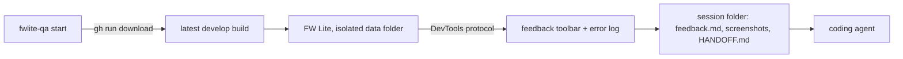

# fwlite-qa

QA a CI build of [FieldWorks Lite](https://github.com/sillsdev/languageforge-lexbox) and hand your feedback to a coding agent.



Nothing is built into FW Lite. On Windows the app's UI is a WebView2, which opens a DevTools port when launched with
`WEBVIEW2_ADDITIONAL_BROWSER_ARGUMENTS=--remote-debugging-port=<port>`. The tool attaches to that port with Playwright,
injects a toolbar, and takes screenshots. Elsewhere it runs FwLiteWeb in a Chrome/Edge window it controls.

## Requirements

- Node 22+
- [GitHub CLI](https://cli.github.com), logged in (`gh auth login`) with read access to the FW Lite repo's Actions artifacts
- Windows: the WebView2 runtime (already present on Windows 10/11)
- Linux/macOS: Chrome or Edge. CI only publishes FwLiteWeb for Linux; on macOS pass `--exe` to a local FwLiteWeb build.

## Use

```sh
npm install
node src/cli.mjs            # latest successful develop build
node src/cli.mjs --run 42168601788
node src/cli.mjs --exe path/to/FwLiteMaui.exe   # a local build
```

The tool opens the built-in example project (`--no-example` to skip that), then:

| Key | Action |
|---|---|
| F8 | pick an element, then write a note about it |
| F9 | drag a region, then write a note about it |
| F7 | a general note |

Each note has a type (🐛 bug, 👎 dislike, 💡 idea, 👍 like) and free text, and is written to disk as soon as you
save it. Esc cancels a capture. ⇄ moves the toolbar to the other side.

The toolbar is invisible to the app: it swallows its own clicks, keys and focus changes before the app's listeners
run, so an open popup or menu stays open while you capture a note about it.

To finish, click **Finish** twice (it closes the app), close the app, or press Ctrl+C in the terminal.

## Session folder

Under `%LOCALAPPDATA%\fwlite-qa\sessions\` (or `~/.cache/fwlite-qa/sessions/`; set `FWLITE_QA_HOME` to move it):

| File | Contents |
|---|---|
| `feedback.md` | every note: text, cropped screenshot, the element it targets (text, labels, attributes, CSS path), errors from the minute before |
| `notes/` | crops and full-window screenshots |
| `HANDOFF.md` | the prompt for the agent: find the code, check whether develop already changed it, size each note, agree a plan with you before changing anything |
| `events.json` | console errors, failed requests, navigation |
| `.app-data/` | the app's data for this session (the example project, logs) |

To hand it off, start a coding agent in your LexBox checkout and say `Read <session>/HANDOFF.md and follow it.`

## Isolation

Each session gets a fresh data folder: FW Lite projects, logs, auth cache, WebView2 profile, and an empty FieldWorks
projects folder in place of the one in the registry, so your real FieldWorks projects are never listed. Analytics and
update checks are off.

One gap: FW Lite saves the last page you visited in MAUI preferences under your user profile, shared with any other
unpackaged FW Lite you run. Builds that include `--start-url` (sillsdev/languageforge-lexbox#2944) ignore it at
launch; for older builds the tool navigates home after attaching. A session still overwrites that saved page.

## Test

```sh
npm run check   # syntax
npm run smoke   # Windows: launches the latest develop build, acts as a tester (including a note on an open popup), checks the session folder
```

## Not yet

- Native windows and dialogs (file pickers, the title bar) are outside the WebView, so the toolbar can't see them.
- Ideas: rrweb replay of the session, hold-to-talk voice notes transcribed locally.
